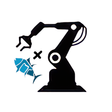
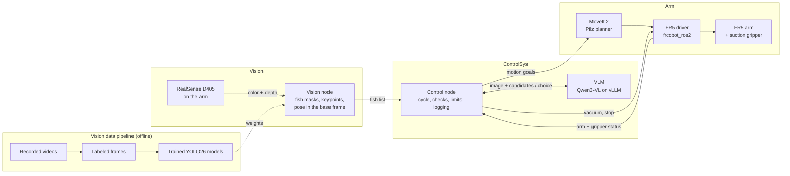

<p align="center">
  
</p>

<h1 align="center">RoboticFishProcessing</h1>

<p align="center"><b>Vision-guided grasping and manipulation for automated fish processing.</b></p>

A FAIRINO FR5 arm with a suction gripper picks whole catfish off a table one at a time and places each with the same heading. A camera on the arm and YOLO models find each fish's pose, a vision-language model (VLM) picks which fish is next, and fixed code checks every decision and owns every motion, safety and retry limit.

> **Status:** Fall 2026 is the design term. The Vision data pipeline (`Vision/data/`) works; `rfp_vision`, `rfp_arm` and `rfp_controlsys` are skeletons. Building, training and trials start next term.

## How the parts work together



One cycle:

1. **Observe:** camera over the table, aligned color + depth.
2. **Find:** YOLO26 masks and keypoints; depth + hand-eye calibration give each fish's position and heading; unreliable detections are flagged.
3. **Decide:** the VLM picks a candidate; fixed code validates it, with a fixed-rule fallback.
4. **Pick and place:** straight approach with vacuum on, hold confirmed by the vacuum switch, carry, set down with a uniform heading, blow-off release.
5. **Log:** every cycle, for grasp success, damage and generalization.

Every failure (no seal, dropped fish, bad VLM answer) has a defined response: retry, skip the fish, or pause for the operator.

**Scope:** whole catfish on either side on a dry table, pick and place only. Not other species, live or frozen fish, conveyors, cycle-time targets, flipping fish or anything after placement. All numbers are in the Requirement Spec.

## Repository

| Folder | Owns |
|---|---|
| [Vision/](Vision/README.md) | Camera, fish detection and pose; the dataset tools and model training |
| [Arm/](Arm/README.md) | Motion, grasp sequence, suction gripper, placement, calibration, safety |
| [ControlSys/](ControlSys/README.md) | Cycle state machine, VLM decisions, validation, failure handling, logging |

Subsystems talk only through the interfaces in Requirement Spec Section 2.7. Root: `pyproject.toml` (packages, one extra per subsystem), `requirements.txt` / `environment.yml` (dev environment), `CLAUDE.md` (notes for AI assistants).

## Hardware and software

| Item | Choice |
|---|---|
| Robot | FAIRINO FR5 6-axis cobot (5 kg payload, 922 mm reach), control box, teach pendant, emergency stop |
| Camera | Intel RealSense D405 RGB-D on the tool flange (eye-in-hand) |
| Gripper | Six 40 mm bellows suction cups, venturi ejector, vacuum and blow-off valves, vacuum switch |
| Compute | PC with an NVIDIA GPU (24 GB or more), Gigabit Ethernet to the FR5 |
| Workcell | Matte light table, diffuse lighting, ChArUco calibration board, stand-in fish |
| Platform | Ubuntu 22.04, ROS 2 Humble, Python 3.10 |
| Motion | MoveIt 2 with the Pilz planner, [frcobot_ros2](https://github.com/FAIR-INNOVATION/frcobot_ros2), RViz 2 and mock hardware for simulation |
| Vision | librealsense, Ultralytics YOLO26 on PyTorch, OpenCV, SAM and Label Studio for labeling, MLflow |
| Control | Qwen3-VL-8B-Instruct-FP8 served by vLLM (OpenAI-compatible API) |
| Logs | rosbag2 (MCAP), pandas, matplotlib |

## Getting started

```bash
git clone https://github.com/Rokawoo/RoboticFishProcessing.git
cd RoboticFishProcessing
conda env create -f environment.yml   # once; after dependency changes: conda env update -f environment.yml --prune
conda activate rfp                    # in VS Code, pick "rfp" as the Python interpreter
pre-commit install                    # once: ruff checks and formats every commit
pytest
```

- Includes PyTorch with CUDA 13.0 (NVIDIA driver 580+; `requirements.txt` has the older-driver option). Without conda: `pip install -r requirements.txt` (Python 3.10), or some extras: `pip install -e ".[dev,arm]"`.
- ROS 2 Humble, MoveIt 2, frcobot_ros2, librealsense and vLLM are system installs on the robot PC.
- Style: [ruff](https://docs.astral.sh/ruff/) (`ruff check .`, `ruff format .`), run by the pre-commit hook and by GitHub on every push.
- Label Studio needs its own environment (it pins `numpy<2`): `conda create -n label-studio python=3.11`, `pip install label-studio`, or Docker `heartexlabs/label-studio`.

**Train a fish model:** [the six steps in Vision/README.md](Vision/README.md#building-the-fish-model). Videos, frames, labels, weights and logs stay out of Git (team dataset store).

## Documentation

| Document | Link |
|---|---|
| Requirement Spec (SRS) | [Confluence](https://rokawoo.atlassian.net/wiki/spaces/RFP/pages/196618/Requirement+Spec) |
| Design Draft | [Confluence](https://rokawoo.atlassian.net/wiki/spaces/RFP/pages/98441/Design+Draft) |
| Project hub | [Confluence](https://rokawoo.atlassian.net/wiki/spaces/RFP/overview) |
| Fall timeline | [Confluence](https://rokawoo.atlassian.net/wiki/spaces/RFP/pages/753666/FALL+Q+-+Project+Timeline) |
| Sprint board | [Jira (RFP)](https://rokawoo.atlassian.net/jira/software/projects/RFP/boards/1) |

Requirement IDs in code and commits use the spec's prefixes: SY system, VS vision, VD vision data and models, CS control, AS arm, SF safety, IF interfaces, HW and SW platform, HC hardware constraints.

## License

[MIT](LICENSE). Ultralytics YOLO is AGPL-3.0: distributing this system or offering it as a service with Ultralytics means meeting AGPL-3.0 (or an Ultralytics Enterprise License).
