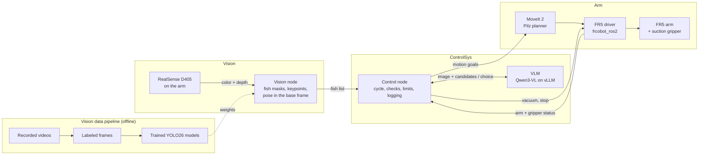

<p align="center">
  
</p>

<h1 align="center">RoboticFishProcessing</h1>

<p align="center"><b>Vision-guided grasping and manipulation for automated fish processing.</b></p>

A FAIRINO FR5 arm with a suction gripper picks whole catfish off a table and places each with the same heading. A camera on the arm and YOLO models find each fish's pose, a vision-language model (VLM) picks the next fish, and fixed code validates every decision and owns every motion, safety and retry limit.

> **Status:** Fall 2026 is the design term. Working: the Vision data pipeline, and a pick-and-place cycle that runs in the [3D simulation](#run-it-in-the-3d-simulation), on recordings and against simulated hardware; first trials on the real arm (controller firmware 3.7) shaped its bring-up, camera calibration and search. To come: the VLM, the pose model.

## How the parts work together



One cycle:

1. **Search:** a quick look from each observation pose in turn, until one sees a fish; every fish seen is remembered, so after a place the arm goes straight to the next.
2. **Focus:** the camera over the fish's middle, level, as high as it takes to see all of it, each look aimed at what the last one saw (a fish cut off at the image's edge: its middle half its expected length from the end that shows).
3. **Find:** YOLO26 masks; depth and the camera's pose give each fish's position, heading (shape, girth, surface slope) and size, measured from the table the camera sees around it; unreliable detections are flagged with what was measured.
4. **Decide:** the VLM picks a candidate; fixed code validates it, with a fixed-rule fallback.
5. **Pick and place:** vacuum on, approach square to the fish's surface where it balances (toward the heavier head) until contact is felt, the camera confirms the hold and watches for a drop, lift, carry just over what lies on the way and lower as one blended move, set down with a uniform heading, release.
6. **Log:** one CSV row per cycle.

While it runs, the camera window shows each fish's outline, the six cups where the grasp puts them and the heading; on the arm a 3D window shows the arm as its joints report, the fish vision found and the depth as points.

Every failure (no seal, dropped fish, bad VLM answer) has a defined response: retry, skip the fish, or pause for the operator.

**Scope:** whole catfish on either side on a dry table, pick and place only. Not other species, live or frozen fish, conveyors, cycle-time targets, flipping fish or anything after placement. Numbers: the Requirement Spec.

## Repository

| Folder | Owns |
|---|---|
| [Vision/](Vision/README.md) | Camera, fish detection and pose; dataset tools and model training |
| [Arm/](Arm/README.md) | Motion, grasp sequence, gripper, placement, calibration, safety |
| [ControlSys/](ControlSys/README.md) | Cycle state machine, VLM decisions, validation, failure handling, logging |
| [Simulation/](Simulation/README.md) | 3D virtual cell (arm, gripper, camera, fish) running the real cycle |
| [Demos/](Demos/) | Taught demos (poses and vacuum steps) for `ControlSys/rfp_controlsys/demo.py` |

Subsystems talk only through the interfaces of Requirement Spec Section 2.7. Root: `setup.ps1` / `setup.sh` (`tools/setup_rfp.py`), `pyproject.toml` (one extra per subsystem), `requirements.txt` / `environment.yml`, `control_panel.yaml`, `CLAUDE.md` (notes for AI assistants).

## Hardware and software

| Item | Choice |
|---|---|
| Robot | FAIRINO FR5 6-axis cobot (5 kg payload, 922 mm reach) |
| Camera | Intel RealSense D405 RGB-D on the tool flange (eye-in-hand) |
| Gripper | Six 40 mm bellows suction cups (3 × 2, 160 × 60 mm between centers; the bellows compress from 40 mm to about 10) on one vacuum line, switched by a solenoid valve on an ESP32 board |
| Compute | PC with an NVIDIA GPU (24 GB or more), Gigabit Ethernet to the FR5 |
| Platform | Ubuntu 22.04, ROS 2 Humble, Python 3.10 |
| Motion | MoveIt 2 with the Pilz planner, [frcobot_ros2](https://github.com/FAIR-INNOVATION/frcobot_ros2) |
| Vision | librealsense, Ultralytics YOLO26 on PyTorch, OpenCV, SAM and Label Studio for labeling, MLflow |
| Control | Qwen3-VL-8B-Instruct-FP8 served by vLLM (OpenAI-compatible API) |

## Getting started

From a fresh clone to the arm picking fish in the 3D simulation. Windows or Linux; no ROS, arm or camera needed.

**1. Install what the setup can't**

- [Git](https://git-scm.com/downloads).
- [Miniconda](https://docs.conda.io/en/latest/miniconda.html) (or Anaconda). On Windows the setup offers to install it with winget if it's missing; on Linux the setup also needs `python3`.
- With an NVIDIA GPU: its driver, 580 or newer (CUDA 13.0). Without one, everything still runs; the fish model just runs on the CPU, slowly.

**2. Clone the repository**

```bash
git clone https://github.com/Rokawoo/RoboticFishProcessing.git
cd RoboticFishProcessing
```

**3. Run the setup**

```bash
.\setup.ps1     # Windows (PowerShell)
./setup.sh      # Linux
```

It creates the conda environment `rfp` (Python 3.10 and everything in `requirements.txt`; the first run downloads several GB, mostly PyTorch), installs the git hooks (ruff on every commit), points VS Code at the environment, downloads the FR5 meshes for the simulation, and checks the GPU and the settings. It ends with `Set up.`, or lists what is `[missing]` and what to do about it.

- If PowerShell won't run scripts: `powershell -ExecutionPolicy Bypass -File .\setup.ps1`.
- `--check` only reports; `--test` also runs the tests at the end.
- Each step is checked first and done only if missing, so run it again after every pull.

**4. Activate the environment**, in every new terminal:

```bash
conda activate rfp
```

**5. Check that it works** (optional):

```bash
pytest -q
```

Tests that need a display, a RealSense camera or the SAM weights are skipped without them.

**6. Run the 3D simulation**

```bash
python main.py --mode sim3d
```

Two windows open: the virtual cell in 3D, and the camera's view with what the fish model found. The arm looks over the table, picks each fish and sets it down in a slot. When it's done, close the 3D window (or press q in it). `main.py` runs `ControlSys/rfp_controlsys/pick_place.py` with the same options; without `--mode`, it asks in a popup. Details: [Run it in the 3D simulation](#run-it-in-the-3d-simulation).

**7. Change something**

- More fish, other scenes, faster: `fish_count`, `seed` and `speed` in the `simulation` section of [control_panel.yaml](control_panel.yaml), then step 6 again.
- The cell's layout (table, pick area, slots): `python main.py --mode setup`, see [Lay it out in 3D](#lay-it-out-in-3d).
- A change to vision, planning or the cycle: run `python Simulation/benchmark.py` before and after it, and compare the two runs with `--compare` (the [benchmark](#run-it-in-the-3d-simulation)).

**8. Where next**

| To | Read |
|---|---|
| Label data and train the fish model | [Vision/README.md](Vision/README.md) |
| Measure and set up the real cell | [Set up the workcell](#set-up-the-workcell) |
| Run it on the arm (robot PC, `./setup.sh --robot`) | [Run it on the arm](#run-it-on-the-arm) |
| Work on the code: the rules it depends on | [CLAUDE.md](CLAUDE.md) and each subsystem's README |

Notes:

- The fish model is in Git: each training run's `weights/best.pt` (the rest of a run, the data and the logs stay out). Train a new one: [Vision/README.md](Vision/README.md#building-the-fish-model).
- PyTorch comes with CUDA 13.0 (NVIDIA driver 580+; `requirements.txt` has the older-driver option).
- ruff (`ruff check .`, `ruff format .`) also runs on every push.
- Label Studio needs its own environment (it pins `numpy<2`): `conda create -n label-studio python=3.11`, `pip install label-studio`.

## Run it in the 3D simulation

No ROS or arm needed; Windows works.

```bash
python ControlSys/rfp_controlsys/pick_place.py --mode sim3d
python ControlSys/rfp_controlsys/pick_place.py --mode sim3d --video run.mp4   # also record the 3D view
```

The arm picks every fish in the pick area and places it in the next slot. When it's done, close the 3D window (or press q in it); q or Esc in the camera window stops it early.

- **Green** is the pick area, **blue** the placement zone with a dot per slot, yellow the camera's view. They come from the workcell file the real arm uses: try a new layout here first.
- Vision uses the newest model in `Vision/trained_cv_models/`. Without one, set `detector: truth` in the `simulation` section of [control_panel.yaml](control_panel.yaml), which also sets the fish (`fish_count`, `seed`), the speed, and `drop: lift` or `carry` to test drop detection.
- Each run's log: `ControlSys/runs/<date>_<time>_sim3d/` (`cycles.csv`, the image of each decision, `report.json`).

**Benchmark:** `python Simulation/benchmark.py` runs the cycle on 20 seeded scenes (0.60 m stand-ins lying anywhere, the simulation's `fish_length`; `--fish-length 0.79` for the big prints) and scores it against the simulator's truth: fish placed, slot and heading error, the cups' distance from each fish's center of mass, failures. Run it before and after a change; `--compare <earlier run>` shows the difference. Results: `Simulation/benchmarks/` (not in Git).

Details: [Simulation/README.md](Simulation/README.md).

## Set up the workcell

[Arm/configs/workcell.yaml](Arm/configs/workcell.yaml) holds the cell's geometry, in meters and degrees; its limits (speeds, grasp, gripper, the wrist's range, the placement heading) are in the `workcell` section of [control_panel.yaml](control_panel.yaml), with their defaults in `Arm/rfp_arm/workcell.py`. A setting is in one of the two files, not both. It ships with placeholder values and the panel's `verified: false`: the real arm won't move until the cell is measured and `verified: true`.

### Lay it out in 3D

```bash
python main.py --mode setup
```

The arm and gripper over the table (gray), with the pick area (green), the placement zone (blue) with its slots and the fish placed there, keep-out zones (red), what the camera sees (yellow), and two rings for the arm's reach: picking, and carrying a fish (slots go inside it). Nothing moves.

- **Size a zone:** drag a corner ball of the table, pick area or placement zone. The opposite corner stays.
- **Place fish:** drag a slot (the big blue balls). Its fish is drawn head first. **Add a slot** puts one where a whole fish fits, or says there's no room.
- **Move a keep-out zone:** drag its red ball. The operator's side, a zone along a whole table edge, goes along the edge nearest where you drop it.
- **Turn the cell:** the two turn buttons move everything 90° about the arm, so the table is on another side of it.
- **Undo** goes back to the saved layout; **Save** writes it.

The rest follows by itself:
- The camera's views follow the pick area.
- The placement zone grows to hold its slots.
- A keep-out zone along a table edge stays along it as the table is sized; every zone turns with the cell.
- Everything is checked after every change. Red is what can't work (out of the arm's reach, a placed fish off the table, the arm in a keep-out zone); yellow is what may not (a fish that can't be lifted there, part of the pick area no view sees, slots closer than a fish is wide). Save with red left asks for a second click.

Save changes only the layout's lines (comments stay; a `.bak` copy of each file is kept), in control_panel.yaml for what it holds (the heading), else in the workcell file. A `verified` cell becomes unverified: check the new zones on the real cell. Every mode prints the same checks when it starts. The placement heading, the keep-out zones' sizes and the observation poses are set in the files ([what to set](#what-to-set)).

### Which way is which

Everything is in the **arm's base frame**: origin in the middle of the arm's base, z up. The controller uses the same frame:

1. On the pendant, jog in **base** coordinates along **+X**. The way the tool moves is +X; mark it on the table.
2. **+Y** is +X turned 90° counter-clockwise, seen from above.

Angles go from +X toward +Y: 0 is +X, 90 is +Y, 180 is −X, −90 is −Y.

### What to set

The cell as it stands by the arm, from above (+X to the right): the table on the arm's right (−Y), the placement zone to the right of the pick area as seen from the arm, which faces −Y (so it is on the left of this picture). `o` is a slot: where a placed fish's middle goes; placed heads point `v` (−Y, `heading_deg: -90`). `O` is the observation pose: the camera over the pick area's middle, which sees all of it, so the search is one look and the arm goes straight over the fish it finds.

```
 y (m)
  0.00   ----------------------------- [arm] --------------------------> +x
                                         |
 -0.15   +----------------------+        |
         | placement zone (blue)|   +----------------------------------+  -0.18
 -0.20   |  o slot 2            |   | pick area (green):               |
         |  v                   |   | fish are expected here           |
 -0.36   |            o slot 1  |   |                O                 |
         |            v         |   |                                  |
 -0.55   +----------------------+   |                                  |
 -0.58                              +----------------------------------+
 -1.00   ====================== operator side (keep out) =====================
       -0.72                 -0.30 -0.17                              0.33   x (m)
```

Turned the other way, or the placements on the other side: `--mode setup` (two buttons turn it all 90° about the arm; drag the zones and slots).

| Setting | What it is | Rules |
|---|---|---|
| `zones.pick_area` | Where fish are expected: a fish's middle must be inside to be picked | Fish outside are ignored |
| `zones.placement` | Where fish are placed | Must not overlap the pick area |
| `placement.slots` | Each placed fish's middle, filled in order | At least 2, inside the placement zone, more than a fish's width apart across the heading (0.2 m for 0.55 m fish), within reach when carrying (0.675 m from the arm's axis at 0.5 m up, with the tool up to 126 mm past the slot toward the head: the cups hold a stand-in ahead of its middle). All full: the run pauses until they're cleared |
| `placement.heading_deg` | Which way placed fish's heads point | |
| `zones.work` | The table: tool, camera and both ends of a held fish stay inside | Must hold both zones, with half a fish length (about 0.4 m) to spare around the pick area |
| `table.z` | Height of the table top | 0 if the arm stands on the table. Vision measures the table around each fish with depth and says if it is more than 15 mm from this: set it then |
| `zones.exclusion` | Boxes the arm never enters (operator, equipment) | The layout check puts the arm's links and gripper against them where it looks, picks and places; MoveIt checks them along every path on the real arm |
| `observation.poses` | Where the camera looks down from while searching, `observation.height` above the table | Together they must see the whole pick area. From 0.45 m the camera sees about 0.85 × 0.48 m, long side along `yaw_deg`: one pose over the middle of a pick area smaller than that sees all of it, and the search is one look (`--mode setup` shows the views). Prefer taught `joints_deg`, with j6 near 0 |
| `observation.close_height` | The highest a look at one fish goes | Looks over a fish are from as high as its expected length needs (`control.look_margin`), between `observation.height` and this. The image's long side spans about 1.9 × (height − the fish's height): 0.62 holds the 0.79 m stand-in |
| `tool.wrist_range_deg` | How far j6 may turn (vacuum tube) | j6 = 0 where the tube hangs untwisted. Plans turn a held fish at most 180°, keep the empty gripper within 90° of the middle where they can and turn the wrist at most 180° in one move; the arm returns to the middle after each place |
| `tool.tcp`, `camera.mount` | Cup faces' middle and camera lens, measured on the gripper | A `dry-run` or `run` measures the mount (its turn and where the lens is across the tool) from a few small moves over a fish while `camera.calibrated` is false, and sets it; `--calibrate` measures it again |
| `gripper` | What switches the vacuum: `driver: serial` and `serial_port` for the valve board | Test: `python Arm/scripts/gripper_bench.py status` |

**The fish:** `vision.fish_type` in control_panel.yaml: `stand_in` (the printed catfish) or `catfish` (real ones). Each has size limits (a fish measured outside them isn't picked) and `balance_ahead_share`: how far ahead of the middle the cups go, toward the heavier head ([vision.yaml](Vision/configs/vision.yaml)).

**Measuring:** bring the middle of the cups over the point, pointing straight down, and run `pick_place.py --mode check` (MoveIt and the command server running, [below](#run-it-on-the-arm)). It prints the cups' position as `TCP (mm)` and the joints as `joints (deg)` (for `joints_deg`). The pendant shows the flange, not the cups: same x and y when pointing down, different z.

**Checking:** every mode refuses a workcell that doesn't fit together (zone outside the work zone, overlapping zones, slot outside its zone, observation pose past the wrist range) and says why, and prints what `--mode setup` checks (reach, views, fish ends). Without the arm:

```bash
python -c "from rfp_arm.workcell import load_workcell, describe; print(*describe(load_workcell()), sep='\n')"
```

Then run the [simulation](#run-it-in-the-3d-simulation) to see whether the camera covers the pick area and the arm reaches every slot.

## Run it on the arm

> The program doesn't set the controller's speed limit or collision detection: set them on the pendant. q or Esc in the camera window, or Ctrl+C, stops the arm; if the program dies mid-move, the move finishes.

Every planned move is checked in the program before it runs: no point of the arm (any joint, the cups, the camera) faster than `tcp_speed_max` (250 mm/s), the zones, the wrist's range, and that the arm doesn't run into itself (its links and the gripper, from their 3D models, with up to 1 cm to spare: [Arm/configs/collision_model.yaml](Arm/configs/collision_model.yaml)). After changing the gripper, run `python Simulation/make_collision_model.py`.

**Once, on the robot PC** (Ubuntu 22.04), with the controller connected (192.168.58.2):

```bash
./setup.sh --robot                     # reads the controller's firmware, e.g. 3.7.8
./setup.sh --robot --firmware 3.7.8    # if it can't (on the pendant: System settings > About)
```

It installs ROS 2 Humble, MoveIt 2, ros2_control and librealsense, adds you to `dialout` (the valve board's port), clones [frcobot_ros2](https://github.com/FAIR-INNOVATION/frcobot_ros2) into `~/rfp_ws/src` at FAIRINO's driver for your firmware (3.7.2 and newer; their ROS 2 driver must match the controller's software), builds it, and sets up the Python environment (`.venv`, which sees ROS's packages). After a firmware update, run it again. Then by hand:

1. Valve board flashed ([Arm/firmware/valve_control](Arm/firmware/valve_control)), its port in control_panel.yaml (`gripper.serial_port`, e.g. `/dev/ttyACM0`).
2. The [workcell](#set-up-the-workcell) measured and verified.

**Each session**: one command. `./robot.sh` sources what was sourced by hand before (ROS 2, every `source .../setup.bash` line of `~/.bashrc`, the workspace with FAIRINO's driver: `~/rfp_ws`, `$RFP_WS` or any folder in your home that has it built) and `.venv`, and a mode that needs the arm starts MoveIt with the FR5's real driver and FAIRINO's command server (mock hardware for `--mode sim`) if they aren't running, and stops them at the end. Before anything moves it checks that MoveIt drives the real arm (a MoveIt left running with mock hardware has other joints: it says so) and that the driver was built for the controller's firmware (after a firmware update: `./setup.sh --robot` builds the new one). The first `dry-run` or `run` with `camera.calibrated: false` measures the camera's mount first, over a fish lying in view, and saves it:

```bash
./robot.sh --mode check        # (bash robot.sh ... if it isn't executable)
./robot.sh ros                 # only MoveIt and the driver, e.g. to keep them running in another terminal
./robot.sh ros rviz:=true      # the same with RViz
```

The launch ([Arm/ros/fr5_bringup.launch.py](Arm/ros/fr5_bringup.launch.py)) is FAIRINO's MoveIt config with `fairino_hardware/FairinoHardwareInterface` given to ros2_control instead of the mock (their files stay as they are), real joint accelerations ([Arm/ros/joint_limits.yaml](Arm/ros/joint_limits.yaml); theirs made every move take seconds), and Pilz's sequence service, so lift, carry and lower run as one blended move. Its log: `ControlSys/runs/ros_launch.log`. `run.bringup: false` in control_panel.yaml: start it yourself.

**Firmware 3.7:** the 3.7 drivers publish one `error_code` (3.8.2 on: `main_error_code` and `sub_error_code`), and the 3.7.5 driver answers a command with `1` for success, the newer ones with `0`; the program reads both and confirms every output it switches from the controller's state. `--mode check` prints which driver it found. A command server that sends no state (a driver for other firmware, the controller unreachable, or a second server competing for it: none is started beside one already running) is named as the cause, and the run goes on without the controller's state, warning that the emergency stop, errors and joint torques can't be read here.

**Bring-up**, each step only once the one before works (`robot.sh` = `./robot.sh`, `pick_place.py --mode X` elsewhere):

| Step | Command | Arm moves | Check |
|---|---|---|---|
| 1 | `robot.sh --mode sim --cycles 2` (mock hardware, no command server) | in the 3D twin | Whole cycles planned and run |
| 2 | `robot.sh --mode check` | no | Driver and firmware; controller flange about 100 mm from MoveIt's tip link (else the frames differ); robot mode automatic; gripper state. Then live: fish found where they lie (3D twin; the red `arm +X` arrow on the table points where the arm's +X is) and the force on the gripper: push the cups, set `contact_force` and `press_force_max` from it |
| 3 | `python Arm/scripts/gripper_bench.py pulse 500` | no | The valve clicks |
| 4 | `robot.sh --mode dry-run --step` | **yes**, vacuum off | First, while `camera.calibrated` is false, the camera's mount is measured over a fish lying wholly in view (a few cm and degrees) and saved; then Enter before each move; approaches stop 50 mm above the fish |
| 5 | `robot.sh --mode run --cycles 1` | **yes** | One fish; then without `--cycles`. `--calibrate` measures the camera again first (after it was moved) |

If the arm went the other way than the fish in the image, the camera is mounted turned from what the workcell says (`camera.mount` `rpy_deg: [0, 0, 180]` is upside down): step 4 measures it, and a run stops by itself when a fish lying still seems to jump as the camera moves. `dry-run` and `run` need `verified: true`. Logs: `ControlSys/runs/`. Option defaults: the `run` section of control_panel.yaml (`twin: false`: no 3D window).

## Control panel

[control_panel.yaml](control_panel.yaml) is where settings are changed (mode, camera, model, gripper port, speeds, grasp forces, vision thresholds, attempt limits). Each setting is written once: its default and explanation in the code's settings class (`rfp_vision/settings.py`, `rfp_controlsys/settings.py`, `rfp_sim/settings.py`, `rfp_arm/workcell.py`), the cell's measurements in `Arm/configs/workcell.yaml`, and any value changed from its default in the panel. Any setting of those classes can be added to the panel under its section.

## Documentation

| Document | Link |
|---|---|
| Requirement Spec (SRS) | [Confluence](https://rokawoo.atlassian.net/wiki/spaces/RFP/pages/196618/Requirement+Spec) |
| Design Draft | [Confluence](https://rokawoo.atlassian.net/wiki/spaces/RFP/pages/98441/Design+Draft) |
| Project hub | [Confluence](https://rokawoo.atlassian.net/wiki/spaces/RFP/overview) |
| Fall timeline | [Confluence](https://rokawoo.atlassian.net/wiki/spaces/RFP/pages/753666/FALL+Q+-+Project+Timeline) |
| Sprint board | [Jira (RFP)](https://rokawoo.atlassian.net/jira/software/projects/RFP/boards/1) |

Requirement IDs in code and commits use the spec's prefixes: SY system, VS vision, VD vision data and models, CS control, AS arm, SF safety, IF interfaces, HW and SW platform, HC hardware constraints.

## License

[MIT](LICENSE). Ultralytics YOLO is AGPL-3.0: distributing this system or offering it as a service with Ultralytics means meeting AGPL-3.0 (or an Ultralytics Enterprise License).
