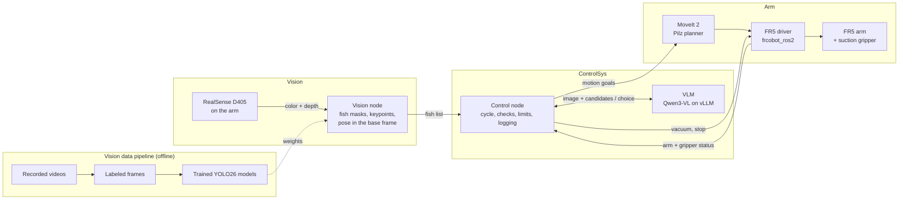

<p align="center">
  
</p>

<h1 align="center">RoboticFishProcessing</h1>

<p align="center"><b>Vision-guided grasping and manipulation for automated fish processing.</b></p>

A FAIRINO FR5 arm with a suction gripper picks whole catfish off a table and places each with the same heading. A camera on the arm and YOLO models find each fish's pose, a vision-language model (VLM) picks the next fish, and fixed code validates every decision and owns every motion, safety and retry limit.

> **Status:** Fall 2026 is the design term. Working: the Vision data pipeline, and a pick-and-place cycle that runs in the [3D simulation](#run-it-in-the-3d-simulation), on recordings and against simulated hardware. Not yet run on the real arm. To come: the VLM, the pose model, calibration tools.

## How the parts work together



One cycle:

1. **Observe:** camera over the table, aligned color + depth.
2. **Find:** YOLO26 masks; depth and the camera's pose give each fish's position, heading and surface slope; unreliable detections are flagged.
3. **Decide:** the VLM picks a candidate; fixed code validates it, with a fixed-rule fallback.
4. **Pick and place:** vacuum on, approach square to the fish's surface until contact is felt, the camera confirms the hold and watches for a drop, carry, set down with a uniform heading, release.
5. **Log:** one CSV row per cycle.

Every failure (no seal, dropped fish, bad VLM answer) has a defined response: retry, skip the fish, or pause for the operator.

**Scope:** whole catfish on either side on a dry table, pick and place only. Not other species, live or frozen fish, conveyors, cycle-time targets, flipping fish or anything after placement. Numbers: the Requirement Spec.

## Repository

| Folder | Owns |
|---|---|
| [Vision/](Vision/README.md) | Camera, fish detection and pose; dataset tools and model training |
| [Arm/](Arm/README.md) | Motion, grasp sequence, gripper, placement, calibration, safety |
| [ControlSys/](ControlSys/README.md) | Cycle state machine, VLM decisions, validation, failure handling, logging |
| [Simulation/](Simulation/README.md) | 3D virtual cell (arm, gripper, camera, fish) running the real cycle |
| [Demos/](Demos/) | Taught demos (poses and vacuum steps) for `ControlSys/rfp_controlsys/demo.py` |

Subsystems talk only through the interfaces of Requirement Spec Section 2.7. Root: `pyproject.toml` (one extra per subsystem), `requirements.txt` / `environment.yml`, `control_panel.yaml`, `CLAUDE.md` (notes for AI assistants).

## Hardware and software

| Item | Choice |
|---|---|
| Robot | FAIRINO FR5 6-axis cobot (5 kg payload, 922 mm reach) |
| Camera | Intel RealSense D405 RGB-D on the tool flange (eye-in-hand) |
| Gripper | Six bellows suction cups (3 × 2) on one vacuum line, switched by a solenoid valve on an ESP32 board |
| Compute | PC with an NVIDIA GPU (24 GB or more), Gigabit Ethernet to the FR5 |
| Platform | Ubuntu 22.04, ROS 2 Humble, Python 3.10 |
| Motion | MoveIt 2 with the Pilz planner, [frcobot_ros2](https://github.com/FAIR-INNOVATION/frcobot_ros2) |
| Vision | librealsense, Ultralytics YOLO26 on PyTorch, OpenCV, SAM and Label Studio for labeling, MLflow |
| Control | Qwen3-VL-8B-Instruct-FP8 served by vLLM (OpenAI-compatible API) |

## Getting started

```bash
git clone https://github.com/Rokawoo/RoboticFishProcessing.git
cd RoboticFishProcessing
conda env create -f environment.yml   # after dependency changes: conda env update -f environment.yml --prune
conda activate rfp
pre-commit install                    # ruff checks and formats every commit
pytest
```

- PyTorch comes with CUDA 13.0 (NVIDIA driver 580+; `requirements.txt` has the older-driver option). Without conda: `pip install -r requirements.txt` (Python 3.10).
- ruff (`ruff check .`, `ruff format .`) also runs on every push.
- Label Studio needs its own environment (it pins `numpy<2`): `conda create -n label-studio python=3.11`, `pip install label-studio`.
- Train a fish model: [Vision/README.md](Vision/README.md#building-the-fish-model). Data, weights and logs stay out of Git.

## Run it in the 3D simulation

No ROS or arm needed; Windows works.

```bash
python ControlSys/rfp_controlsys/pick_place.py --mode sim3d
python ControlSys/rfp_controlsys/pick_place.py --mode sim3d --video run.mp4   # also record the 3D view
```

The arm picks every fish in the pick area and places it in the next slot. When it's done, close the 3D window (or press q in it); q or Esc in the camera window stops it early.

- **Green** is the pick area, **blue** the placement zone with a dot per slot, yellow the camera's view. They come from the workcell file the real arm uses: try a new layout here first.
- Vision uses the newest model in `Vision/trained_cv_models/`. Without one, set `detector: truth` in the `simulation` section of [control_panel.yaml](control_panel.yaml), which also sets the fish (`fish_count`, `seed`), the speed, and `drop: lift` or `carry` to test drop detection.
- Each run's log: `ControlSys/runs/<date>_<time>_sim3d/` (`cycles.csv`, the image of each decision, `report.json`).

Details: [Simulation/README.md](Simulation/README.md).

## Set up the workcell

[Arm/configs/workcell.yaml](Arm/configs/workcell.yaml) holds the cell's geometry and limits, in meters and degrees; the `workcell` section of [control_panel.yaml](control_panel.yaml) overrides any of it. It ships with placeholder values and `verified: false`: the real arm won't move until the cell is measured and `verified: true`.

### Which way is which

Everything is in the **arm's base frame**: origin in the middle of the arm's base, z up. The controller uses the same frame:

1. On the pendant, jog in **base** coordinates along **+X**. The way the tool moves is +X; mark it on the table.
2. **+Y** is +X turned 90° counter-clockwise, seen from above.

Angles go from +X toward +Y: 0 is +X, 90 is +Y, 180 is −X, −90 is −Y.

### What to set

The placeholder layout, from above. `o-->` is a slot: where a placed fish's middle goes, and which way its head points.

```
 y (m)
  0.72        |                   +-----------------------+
              |                   | placement zone (blue) |
  0.60        |                   |         o--> slot 2   |
  0.40        |                   |         o--> slot 1   |
  0.30        |                   +-----------------------+
  0.15        |               +-------------------------------+
              |               | pick area (green):            |
              |               | fish are expected here        |
  0.00       [arm] -----------|                               |----------> +x
              |               |                               |
 -0.35        |               +-------------------------------+
            0.00            0.20            0.40            0.60    x (m)
```

| Setting | What it is | Rules |
|---|---|---|
| `zones.pick_area` | Where fish are expected: a fish's middle must be inside to be picked | Fish outside are ignored |
| `zones.placement` | Where fish are placed | Must not overlap the pick area |
| `placement.slots` | Each placed fish's middle, filled in order | At least 2, inside the placement zone, more than a fish's width apart across the heading (0.2 m for 0.55 m fish). All full: the run pauses until they're cleared |
| `placement.heading_deg` | Which way placed fish's heads point | |
| `zones.work` | The table: tool, camera and both ends of a held fish stay inside | Must hold both zones, with half a fish length (about 0.4 m) to spare around the pick area |
| `table.z` | Height of the table top | 0 if the arm stands on the table |
| `zones.exclusion` | Boxes the arm never enters (operator, equipment) | |
| `observation.poses` | Where the camera looks down from, `observation.height` above the table | Together they must see the whole pick area. From 0.45 m the camera sees about 0.85 × 0.50 m, long side along `yaw_deg`. Prefer taught `joints_deg`, with j6 near 0 |
| `tool.wrist_range_deg` | How far j6 may turn (vacuum tube) | j6 = 0 where the tube hangs untwisted |
| `tool.tcp`, `camera.mount` | Cup faces' middle and camera lens, measured on the gripper | Then `camera.calibrated: true` |
| `gripper` | What switches the vacuum: `driver: serial` and `serial_port` for the valve board | Test: `python Arm/scripts/gripper_bench.py status` |

**Measuring:** bring the middle of the cups over the point, pointing straight down, and run `pick_place.py --mode check` (MoveIt and the command server running, [below](#run-it-on-the-arm)). It prints the cups' position as `TCP (mm)` and the joints as `joints (deg)` (for `joints_deg`). The pendant shows the flange, not the cups: same x and y when pointing down, different z.

**Checking:** every mode refuses a workcell that doesn't fit together (zone outside the work zone, overlapping zones, slot outside its zone, observation pose past the wrist range) and says why. Without the arm:

```bash
python -c "from rfp_arm.workcell import load_workcell, describe; print(*describe(load_workcell()), sep='\n')"
```

Then run the [simulation](#run-it-in-the-3d-simulation) to see whether the camera covers the pick area and the arm reaches every slot.

## Run it on the arm

> The program doesn't set the controller's speed limit or collision detection: set them on the pendant. q or Esc in the camera window, or Ctrl+C, stops the arm; if the program dies mid-move, the move finishes.

**Once, on the robot PC:**

1. ROS 2 Humble, MoveIt 2 and [frcobot_ros2](https://github.com/FAIR-INNOVATION/frcobot_ros2) built in a ROS workspace; librealsense.
2. This repository in the Python that ROS uses: `pip install -e ".[vision,arm,control]"`.
3. Real driver instead of the mock: in `fairino5_v6_moveit2_config/config/fairino5_v6_robot.ros2_control.xacro`, `fairino_hardware/FairinoHardwareInterface` instead of `mock_components/GenericSystem`. Keep a mock copy for `--mode sim`.
4. Valve board flashed ([Arm/firmware/valve_control](Arm/firmware/valve_control)), its port in control_panel.yaml (`gripper.serial_port`, e.g. `/dev/ttyACM0`). Serial access: `sudo usermod -aG dialout $USER`, then log in again.
5. The [workcell](#set-up-the-workcell) measured and verified.

**Each session**, three terminals, each with `source /opt/ros/humble/setup.bash` and the workspace's `install/setup.bash`:

```bash
ros2 launch fairino5_v6_moveit2_config demo.launch.py          # driver, MoveIt, RViz
ros2 run fairino_hardware ros2_cmd_server                      # controller I/O and state
python ControlSys/rfp_controlsys/pick_place.py --mode check    # the pipeline
```

**Bring-up**, each step only once the one before works (`pick_place.py` = `ControlSys/rfp_controlsys/pick_place.py`):

| Step | Command | Arm moves | Check |
|---|---|---|---|
| 1 | `pick_place.py --mode sim --cycles 2` (mock driver, no command server) | in RViz | Whole cycles planned and run |
| 2 | `pick_place.py --mode observe` | no | Fish found where they lie |
| 3 | `pick_place.py --mode check` | no | Controller flange about 100 mm from MoveIt's tip link (else the frames differ); gripper state |
| 4 | `python Arm/scripts/gripper_bench.py pulse 500` | no | The valve clicks |
| 5 | `pick_place.py --mode feel` | no | Push the cups; set `contact_force` and `press_force_max` from the forces shown |
| 6 | `pick_place.py --mode dry-run --step` | **yes**, vacuum off | Enter before each move; approaches stop 50 mm above the fish |
| 7 | `pick_place.py --mode run --cycles 1` | **yes** | One fish; then without `--cycles` |

`dry-run` and `run` need `verified: true`; `run` also `camera.calibrated: true`. Logs: `ControlSys/runs/`. Option defaults: the `run` section of control_panel.yaml.

## Control panel

[control_panel.yaml](control_panel.yaml) holds the settings changed most often (mode, camera, model, gripper port, speeds, grasp forces, vision thresholds, attempt limits) and overrides the subsystem files: `Arm/configs/workcell.yaml`, `Vision/configs/vision.yaml`, `ControlSys/configs/control.yaml`, `Simulation/sim.yaml`. Any of their settings can be added to it.

## Documentation

| Document | Link |
|---|---|
| Requirement Spec (SRS) | [Confluence](https://rokawoo.atlassian.net/wiki/spaces/RFP/pages/196618/Requirement+Spec) |
| Design Draft | [Confluence](https://rokawoo.atlassian.net/wiki/spaces/RFP/pages/98441/Design+Draft) |
| Project hub | [Confluence](https://rokawoo.atlassian.net/wiki/spaces/RFP/overview) |
| Fall timeline | [Confluence](https://rokawoo.atlassian.net/wiki/spaces/RFP/pages/753666/FALL+Q+-+Project+Timeline) |
| Sprint board | [Jira (RFP)](https://rokawoo.atlassian.net/jira/software/projects/RFP/boards/1) |

Requirement IDs in code and commits use the spec's prefixes: SY system, VS vision, VD vision data and models, CS control, AS arm, SF safety, IF interfaces, HW and SW platform, HC hardware constraints.

## License

[MIT](LICENSE). Ultralytics YOLO is AGPL-3.0: distributing this system or offering it as a service with Ultralytics means meeting AGPL-3.0 (or an Ultralytics Enterprise License).
