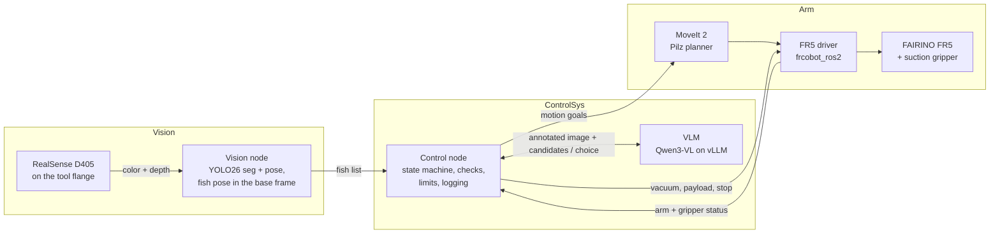

# RoboticFishProcessing

**Vision-guided grasping and manipulation for automated fish processing.**

A FAIRINO FR5 arm with a suction gripper picks randomly oriented whole catfish off a table, one at a time, and places each one in a placement zone with the same heading. An RGB-D camera on the arm and YOLO models find each fish and its pose, a vision-language model (VLM) chooses which fish to pick next, and fixed code checks every decision and owns every motion, safety and retry limit.

> **Status:** Fall 2026 is the requirements and design term, so this repository is the skeleton only. Building, data capture, training and trials start next term. The requirements and design live in Confluence (see [Documentation](#documentation)).

## About

Fish are a hard case for robotic handling: their bodies are wet, slippery, deformable and never the same shape twice, which is why people still handle them on processing lines. Skilled workers judge each fish's position, orientation and form at a glance and adjust their grip to match. This project does the same with a robot: it estimates the pose and shape of each fish from camera images and uses that estimate to choose a grasp and plan the arm motion, with no reprogramming per fish or per species.

The vision system and the arm are developed as one system rather than two parts, so that seeing and reaching feed each other. The system is evaluated on real hardware with fish of different sizes, shapes and surface conditions, measuring grasp reliability, handling consistency and generalization to fish it has never seen. The goal is a reproducible method and an empirical characterization of vision-guided grasping for fish processing, in support of safer, more efficient and more resilient domestic food production.

### Scope

- Whole catfish lying on their left or right side on a dry table
- Pick and place only: each fish ends up in a placement slot with a uniform heading
- Out of scope: other species, live or frozen fish, tanks and conveyors, cycle-time targets, turning fish over, and any processing after placement

Fish sizes, accuracy targets and every other number are in the Requirement Spec. They are all targets that the team confirms during testing.

## How it works



One pick-and-place cycle:

1. **Observe.** The arm moves the camera to an observation pose above the table and captures aligned color and depth frames.
2. **Find the fish.** Two YOLO26 models segment each fish and find its keypoints. Depth and the hand-eye calibration turn these into each fish's position and heading in the arm base frame. Checks flag unreliable detections, and the vision node publishes a fish list.
3. **Decide.** The control node sends the VLM an annotated image and the list of candidate fish, and the VLM chooses which fish to pick. Fixed code validates every answer and falls back to a fixed rule if the VLM fails.
4. **Grasp and place.** The arm approaches in a straight line with the vacuum on, confirms the hold with the vacuum switch, lifts, carries the fish to a free slot, sets it down with a uniform heading, releases it with a blow-off and retreats.
5. **Log.** Every cycle is recorded so that grasp success, damage and generalization to unseen fish can be measured.

Failures such as no seal, a dropped fish or a bad VLM answer each have a defined response: retry, skip the fish, or pause for the operator.

## Repository layout

```
RoboticFishProcessing/
├── Vision/         # camera, detection, pose estimation, dataset and model tools
│   ├── rfp_vision/     Python package (runtime vision node)
│   ├── data/           dataset pipeline, one folder per stage
│   │   ├── preprocessing/  capture, frame extraction, filtering
│   │   ├── annotating/     labeling, augmentation and label review
│   │   ├── dataset/        frames, labels and the train/val split (not in Git)
│   │   └── training/       training and evaluation
│   ├── trained_cv_models/  one folder per training run (not in Git)
│   ├── configs/
│   └── tests/
├── Arm/            # motion, grasp sequence, suction gripper, placement, calibration, safety
│   ├── rfp_arm/
│   ├── scripts/        calibration and bench tools
│   ├── configs/
│   └── tests/
├── ControlSys/     # run and cycle state machine, VLM decisions, validation, failure handling, logging
│   ├── rfp_controlsys/
│   ├── prompts/        VLM prompt templates
│   ├── configs/
│   └── tests/
├── pyproject.toml      # packages, per subsystem (optional extras)
├── environment.yml     # conda dev environment (uses requirements.txt)
├── requirements.txt    # pip: all extras, plus PyTorch with CUDA
├── CLAUDE.md           # notes for AI coding assistants working on this repo
└── LICENSE
```

Each subsystem folder has its own README with what it owns and which Requirement Spec sections it implements. The three subsystems talk only through the interfaces in Requirement Spec Section 2.7, so any one of them can be rebuilt without touching the others.

## Hardware

| Item | Choice |
|---|---|
| Robot | FAIRINO FR5 6-axis collaborative arm (5 kg payload, 922 mm reach), control box, teach pendant and emergency stop |
| Camera | Intel RealSense D405 RGB-D stereo camera on the tool flange (eye-in-hand), USB 3 to the control PC |
| Gripper | Six 40 mm bellows suction cups in 3 rows of 2, venturi ejector off the arm, vacuum and blow-off valves on the control box outputs, vacuum switch for hold sensing, air compressor |
| Compute | Control PC with an NVIDIA GPU with 24 GB or more (CUDA 12), Gigabit Ethernet to the FR5 control box |
| Workcell | Matte, light-colored textured table, diffuse lighting, ChArUco calibration board, stand-in fish |

## Software

| Layer | Software |
|---|---|
| Platform | Ubuntu 22.04 LTS, ROS 2 Humble, Python 3.10 |
| Robot | MoveIt 2 with the Pilz industrial motion planner, FAIRINO [frcobot_ros2](https://github.com/FAIR-INNOVATION/frcobot_ros2), ros2_control mock hardware and RViz 2 for simulation |
| Vision | librealsense 2.51.1+ (pyrealsense2, realsense2_camera), Ultralytics YOLO26 segmentation and pose models on PyTorch 2, OpenCV, NumPy, imagehash, Label Studio, MLflow |
| Control | Qwen3-VL-8B-Instruct-FP8 served locally by vLLM through an OpenAI-compatible API |
| Data | rosbag2 with MCAP storage, pandas, matplotlib |

## Getting started

ROS 2 Humble, MoveIt 2, frcobot_ros2, librealsense and vLLM are installed system-wide (apt, source or their own installers), not through pip or conda.

For development (the Vision data pipeline, training, tests), create the conda environment. It installs every Python package of this repository, including PyTorch with CUDA:

```bash
git clone https://github.com/Rokawoo/RoboticFishProcessing.git
cd RoboticFishProcessing
conda env create -f environment.yml   # once; after pyproject.toml changes: conda env update -f environment.yml --prune
conda activate rfp                    # in VS Code, pick "rfp" as the Python interpreter
pytest
```

Without conda, any Python 3.10 environment works the same way: `pip install -r requirements.txt`. To install only part of the project, pick extras instead, e.g. `pip install -e ".[dev,arm]"`. PyTorch comes from the CUDA 13.0 index, which needs NVIDIA driver 580 or newer; `requirements.txt` says how to switch for an older driver. Check the GPU is used with `python -c "import torch; print(torch.cuda.is_available())"`.

**Label Studio** runs in its own environment, because it pins older libraries (such as `numpy<2`) that clash with this one: `conda create -n label-studio python=3.11`, then `conda activate label-studio` and `pip install label-studio`, or use its official Docker image (`heartexlabs/label-studio`). It opens in the browser, and its YOLO exports go next to the images in `Vision/data/dataset/image_sets/` (see [Vision/data/README.md](Vision/data/README.md)).

## Data and models

Video clips (`.bag` or `.db3`, and `.mp4`), extracted frames, labels, model weights, MLflow runs and rosbag2 logs are not stored in Git; they go on the team's dataset store, and `.gitignore` keeps them out of the repository. Every clip and frame is named by fish ID and view, and the dataset is split into train, validation and test sets by fish, so no fish appears in more than one set and the test results reflect fish the models have never seen.

## Documentation

| Document | Link |
|---|---|
| Requirement Spec (SRS) | [Confluence](https://rokawoo.atlassian.net/wiki/spaces/RFP/pages/196618/Requirement+Spec) |
| Design Draft | [Confluence](https://rokawoo.atlassian.net/wiki/spaces/RFP/pages/98441/Design+Draft) |
| Project hub | [Confluence](https://rokawoo.atlassian.net/wiki/spaces/RFP/overview) |
| Fall timeline | [Confluence](https://rokawoo.atlassian.net/wiki/spaces/RFP/pages/753666/FALL+Q+-+Project+Timeline) |
| Sprint board | [Jira (RFP)](https://rokawoo.atlassian.net/jira/software/projects/RFP/boards/1) |

Requirement IDs in code and commits use the spec's prefixes: SY system, VS vision, VD vision data and models, CS control, AS arm, SF safety, IF interfaces, HW and SW platform, HC hardware constraints.

## License

The code in this repository is released under the [MIT License](LICENSE).

Dependencies keep their own licenses. In particular, Ultralytics YOLO is licensed under AGPL-3.0, so a version of this system that is distributed or offered as a service together with Ultralytics must meet the AGPL-3.0 terms (or use an Ultralytics Enterprise License).
