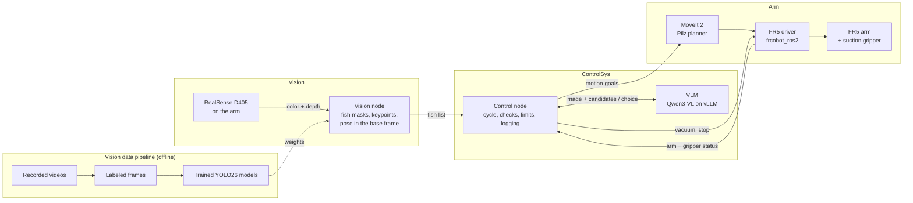

<p align="center">
  
</p>

<h1 align="center">RoboticFishProcessing</h1>

<p align="center"><b>Vision-guided grasping and manipulation for automated fish processing.</b></p>

A FAIRINO FR5 arm with a suction gripper picks whole catfish off a table, one at a time, and places each one with the same heading. A camera on the arm and YOLO models find each fish and its pose, a vision-language model (VLM) chooses which fish to pick next, and fixed code checks every decision and owns every motion, safety and retry limit.

Fish are wet, slippery and never the same shape twice, which is why people still handle them on processing lines. This robot estimates each fish's pose and shape from the camera and plans the grasp from that, with no reprogramming per fish. It is evaluated on real hardware for grasp reliability, consistency and generalization to fish it has never seen.

> **Status:** Fall 2026 is the requirements and design term. The Vision data pipeline (`Vision/data/`) works; the runtime packages `rfp_vision`, `rfp_arm` and `rfp_controlsys` are skeletons. Building, training and trials start next term.

## How the parts work together



One pick-and-place cycle:

1. **Observe:** the arm holds the camera over the table and captures aligned color and depth frames.
2. **Find the fish:** YOLO26 segments each fish and finds its keypoints; depth and the hand-eye calibration turn them into each fish's position and heading. Unreliable detections are flagged.
3. **Decide:** the VLM picks a fish from the candidates. Fixed code validates the answer and falls back to a fixed rule if the VLM fails.
4. **Pick and place:** straight-line approach with the vacuum on, hold confirmed by the vacuum switch, lift, carry, set down with a uniform heading, blow-off release, retreat.
5. **Log:** every cycle is recorded to measure grasp success, damage and generalization.

No seal, a dropped fish or a bad VLM answer each have a defined response: retry, skip the fish, or pause for the operator.

**Scope:** whole catfish lying on either side on a dry table, pick and place only. Not in scope: other species, live or frozen fish, tanks and conveyors, cycle-time targets, turning fish over, processing after placement. Fish sizes, accuracy targets and every other number are in the Requirement Spec.

## Repository

| Folder | Owns |
|---|---|
| [Vision/](Vision/README.md) | Camera, fish detection and pose; the dataset tools and model training |
| [Arm/](Arm/README.md) | Motion, grasp sequence, suction gripper, placement, calibration, safety |
| [ControlSys/](ControlSys/README.md) | Cycle state machine, VLM decisions, validation, failure handling, logging |

The subsystems talk only through the interfaces in Requirement Spec Section 2.7, so each can be rebuilt without touching the others. At the root: `pyproject.toml` (packages, with one extra per subsystem), `requirements.txt` and `environment.yml` (the dev environment), `CLAUDE.md` (notes for AI coding assistants).

## Hardware and software

| Item | Choice |
|---|---|
| Robot | FAIRINO FR5 6-axis cobot (5 kg payload, 922 mm reach), control box, teach pendant, emergency stop |
| Camera | Intel RealSense D405 RGB-D on the tool flange (eye-in-hand) |
| Gripper | Six 40 mm bellows suction cups, venturi ejector, vacuum and blow-off valves, vacuum switch |
| Compute | PC with an NVIDIA GPU (24 GB or more), Gigabit Ethernet to the FR5 |
| Workcell | Matte light table, diffuse lighting, ChArUco calibration board, stand-in fish |
| Platform | Ubuntu 22.04, ROS 2 Humble, Python 3.10 |
| Motion | MoveIt 2 with the Pilz planner, [frcobot_ros2](https://github.com/FAIR-INNOVATION/frcobot_ros2), RViz 2 and mock hardware for simulation |
| Vision | librealsense, Ultralytics YOLO26 on PyTorch, OpenCV, SAM and Label Studio for labeling, MLflow |
| Control | Qwen3-VL-8B-Instruct-FP8 served by vLLM (OpenAI-compatible API) |
| Logs | rosbag2 (MCAP), pandas, matplotlib |

## Getting started

```bash
git clone https://github.com/Rokawoo/RoboticFishProcessing.git
cd RoboticFishProcessing
conda env create -f environment.yml   # once; after dependency changes: conda env update -f environment.yml --prune
conda activate rfp                    # in VS Code, pick "rfp" as the Python interpreter
pre-commit install                    # once: ruff checks and formats every commit
pytest
```

- The environment has every Python package of the project, including PyTorch with CUDA 13.0 (NVIDIA driver 580 or newer; `requirements.txt` says how to use an older driver). Without conda: `pip install -r requirements.txt` in any Python 3.10 environment, or only some extras, e.g. `pip install -e ".[dev,arm]"`.
- ROS 2 Humble, MoveIt 2, frcobot_ros2, librealsense and vLLM are system installs on the robot PC, not pip packages.
- Code style is [ruff](https://docs.astral.sh/ruff/): `ruff check .` and `ruff format .`. The pre-commit hook runs both, and GitHub runs them with the tests on every push.
- Label Studio needs its own environment (it pins `numpy<2`): `conda create -n label-studio python=3.11`, then `pip install label-studio`, or its Docker image `heartexlabs/label-studio`.

To build the dataset and train a fish model, follow [the six steps in Vision/README.md](Vision/README.md#building-the-fish-model). Videos, frames, labels, model weights and logs are not stored in Git: they go on the team's dataset store, and `.gitignore` keeps them out.

## Documentation

| Document | Link |
|---|---|
| Requirement Spec (SRS) | [Confluence](https://rokawoo.atlassian.net/wiki/spaces/RFP/pages/196618/Requirement+Spec) |
| Design Draft | [Confluence](https://rokawoo.atlassian.net/wiki/spaces/RFP/pages/98441/Design+Draft) |
| Project hub | [Confluence](https://rokawoo.atlassian.net/wiki/spaces/RFP/overview) |
| Fall timeline | [Confluence](https://rokawoo.atlassian.net/wiki/spaces/RFP/pages/753666/FALL+Q+-+Project+Timeline) |
| Sprint board | [Jira (RFP)](https://rokawoo.atlassian.net/jira/software/projects/RFP/boards/1) |

Requirement IDs in code and commits use the spec's prefixes: SY system, VS vision, VD vision data and models, CS control, AS arm, SF safety, IF interfaces, HW and SW platform, HC hardware constraints.

## License

[MIT](LICENSE). Dependencies keep their own licenses; notably Ultralytics YOLO is AGPL-3.0, so a version of this system distributed or offered as a service with Ultralytics must meet the AGPL-3.0 terms (or use an Ultralytics Enterprise License).
