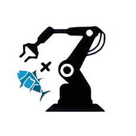
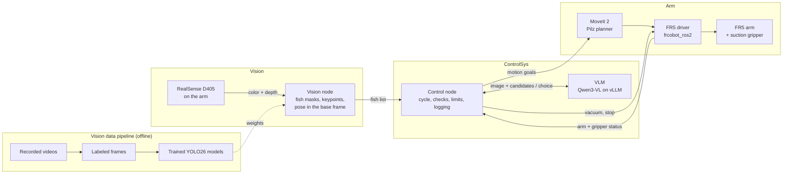

<p align="center">
  
</p>

<h1 align="center">RoboticFishProcessing</h1>

<p align="center"><b>Vision-guided grasping and manipulation for automated fish processing.</b></p>

A FAIRINO FR5 arm with a suction gripper picks whole catfish off a table and places each with the same heading. A camera on the arm and YOLO models find each fish, a vision-language model (VLM) chooses the next one, and fixed code checks every decision and owns every motion, safety and retry limit.

> **Status:** Fall 2026 is the design term. Working: the Vision data pipeline and a pick-and-place cycle that runs in the [3D simulation](#run-it-in-the-3d-simulation) and on recordings; first trials on the real arm (firmware 3.7). To come: the VLM, the pose model.

## How the parts work together



One cycle:

1. **Search:** look from the observation poses until one sees a fish.
2. **Focus:** look again from straight above the fish, high enough to see all of it.
3. **Find:** YOLO26 outlines and depth give each fish's position, heading and size.
4. **Decide:** the VLM picks a fish; fixed code checks the choice, with a fixed-rule fallback.
5. **Pick and place:** vacuum on, down onto the fish where it balances until the cups feel it, the hold confirmed by the camera, lift, carry and lower in one move, release with the uniform heading.
6. **Log:** one CSV row per cycle.

Every failure (no seal, dropped fish, bad VLM answer) is retried, skipped, or handed to the operator. Scope: whole catfish on a dry table, pick and place only; the numbers are in the Requirement Spec.

## Repository

| Folder | Owns |
|---|---|
| [Vision/](Vision/README.md) | Camera, fish detection and pose; dataset tools and model training |
| [Arm/](Arm/README.md) | Motion, grasp sequence, gripper, placement, calibration, safety |
| [ControlSys/](ControlSys/README.md) | Cycle, VLM decisions, validation, failure handling, logging |
| [Simulation/](Simulation/README.md) | 3D virtual cell running the real cycle |
| [Demos/](Demos/) | Taught demos for `ControlSys/rfp_controlsys/demo.py` |

At the root: `setup.ps1` / `setup.sh`, `main.py`, [control_panel.yaml](control_panel.yaml) (the settings you change), `pyproject.toml`, `requirements.txt`, `CLAUDE.md` (notes for AI assistants).

## Hardware and software

| Item | Choice |
|---|---|
| Robot | FAIRINO FR5 6-axis cobot (5 kg payload, 922 mm reach) |
| Camera | Intel RealSense D405 RGB-D on the tool flange |
| Gripper | Six 40 mm bellows suction cups (3 × 2) on one vacuum line, switched by a solenoid valve on an ESP32 board |
| Compute | PC with an NVIDIA GPU (24 GB or more), Gigabit Ethernet to the FR5 |
| Platform | Ubuntu 22.04, ROS 2 Humble, Python 3.10 |
| Motion | MoveIt 2 with the Pilz planner, [frcobot_ros2](https://github.com/FAIR-INNOVATION/frcobot_ros2) |
| Vision | librealsense, Ultralytics YOLO26 on PyTorch, OpenCV; SAM and Label Studio for labeling; MLflow |
| Control | Qwen3-VL-8B-Instruct-FP8 served by vLLM |

## Getting started

From a fresh clone to the arm picking fish in the 3D simulation, on Windows or Linux, with no ROS, arm or camera.

1. Install [Git](https://git-scm.com/downloads) and [Miniconda](https://docs.conda.io/en/latest/miniconda.html) (on Windows the setup offers to install it). With an NVIDIA GPU: driver 580 or newer; without one, the fish model runs on the CPU, slowly.
2. Clone and set up:

   ```bash
   git clone https://github.com/Rokawoo/RoboticFishProcessing.git
   cd RoboticFishProcessing
   .\setup.ps1     # Windows (PowerShell; blocked: powershell -ExecutionPolicy Bypass -File .\setup.ps1)
   ./setup.sh      # Linux
   ```

   It creates the conda environment `rfp` (the first run downloads several GB), installs the git hooks, downloads the FR5 meshes for the simulation, and ends with `Set up.` or what is missing. Run it again after every pull; `--check` only reports, `--test` also runs the tests.
3. In every new terminal: `conda activate rfp`. Optional check: `pytest -q`.
4. Run the simulation: `python main.py --mode sim3d`. The 3D cell and the camera's view open; the arm picks each fish and sets it down. Close the 3D window (or press q) when it's done.

Then:

- More fish, other scenes, faster: `fish_count`, `seed`, `speed` in the `simulation` section of [control_panel.yaml](control_panel.yaml).
- The cell's layout: `python main.py --mode setup` ([Lay it out in 3D](#lay-it-out-in-3d)).
- A change to vision, planning or the cycle: `python Simulation/benchmark.py` before and after, compared with `--compare`.
- Label data and train the fish model: [Vision/README.md](Vision/README.md). The model in use is in Git (each run's `weights/best.pt`).
- Run it on the real arm: [Run it on the arm](#run-it-on-the-arm).

## Run it in the 3D simulation

```bash
python main.py --mode sim3d
python main.py --mode sim3d --video run.mp4   # also record the 3D view
```

The arm picks every fish in the pick area and places it in a slot, the slots in turn. Green is the pick area, blue the placement zone and its slots, yellow the camera's view; what vision found is drawn over the true fish. q or Esc in the camera window stops it. Without a trained model, set `detector: truth` in the panel's `simulation` section. Logs: `ControlSys/runs/`.

**Benchmark:** `python Simulation/benchmark.py` runs the cycle on 20 seeded scenes and scores it against the simulator's truth (fish placed, slot and heading error, where the cups took each fish, failures, time). `--compare <earlier run>` shows the difference; `--fish 2` for anything about placing. Details: [Simulation/README.md](Simulation/README.md).

## Set up the workcell

[Arm/configs/workcell.yaml](Arm/configs/workcell.yaml) holds the cell's geometry; speeds, forces and the other limits are in [control_panel.yaml](control_panel.yaml). It ships with placeholders and `verified: false`: the real arm won't move until the cell is measured and the panel says `verified: true`.

### Lay it out in 3D

```bash
python main.py --mode setup
```

The arm over the table, with the pick area (green), the placement zone and its slots (blue), keep-out zones (red), the camera's views (yellow) and the arm's reach. Drag a corner to size a zone, a blue ball to move a slot, a red ball to move a keep-out zone; the turn buttons move the cell 90° about the arm. Everything is checked as you go: red can't work, yellow may not. **Save** writes only the layout's lines (with a `.bak` copy) and makes a verified cell unverified. Every mode prints the same checks when it starts.

### Which way is which

Everything is in the **arm's base frame**, the controller's too: origin in the middle of the base, z up. Jog the pendant in base coordinates along +X: that is +X. +Y is +X turned 90° counter-clockwise seen from above. Angles go from +X toward +Y (90 is +Y, −90 is −Y).

### What to set

The cell as shipped, from above: `o` the slot (placed heads point `v`, `heading_deg: -90`), `O` the observation pose. From 0.45 m the camera sees 0.68 × 0.38 m of the pick area (`vision.hfov_deg` 74); a fish past the view's edge gets a closer look.

```
 y (m)
  0.90   ====================== operator side (keep out) =====================
  0.60   =====================================================================
  0.00   ----------------------------- [arm] --------------------------> +x
                                         |
 -0.11   +----------------------+        |
         | placement zone (blue)|        |
 -0.18   |                      |   +----------------------------------+
         |                      |   | pick area (green):               |
 -0.37   |      o slot 1        |   | fish are expected here           |
         |      v               |   |                O                 |
 -0.60   +----------------------+   |                                  |
 -0.62                              +----------------------------------+
       -0.69                 -0.30 -0.225                             0.28   x (m)
```

| Setting | What it is | Rules |
|---|---|---|
| `zones.pick_area` | Where fish are picked: a fish's middle must be inside | |
| `zones.placement` | Where fish are placed | Not overlapping the pick area |
| `placement.slots` | Where placed fish's middles go, in turn | One is enough (each placed fish is taken away); in the placement zone, within reach when carrying |
| `placement.heading_deg` | Which way placed heads point (panel) | |
| `zones.work` | The table: the tool and a held fish's ends stay over it | Half a fish length to spare around the pick area |
| `table.z` | Height of the table top | A run says when the camera measures it more than 15 mm off |
| `zones.exclusion` | Boxes the arm never enters (operator, equipment) | |
| `observation.poses` | Where the search looks from, `observation.height` above the table | Prefer taught `joints_deg`, with j6 near 0 |
| `observation.close_height` | The highest look over one fish | High enough to see a whole fish |
| `tool.wrist_range_deg` | How far j6 may turn (vacuum tube; panel) | j6 = 0 where the tube hangs free |
| `tool.tcp`, `camera.mount` | The cups' middle and the camera lens on the gripper | The first `dry-run` or `run` measures the mount; `--calibrate` again |
| `gripper` | What switches the vacuum: `driver: serial`, `serial_port` (panel) | Test: `python Arm/scripts/gripper_bench.py status` |

**The fish:** `vision.fish_type` in the panel, `stand_in` (printed) or `catfish` (real). Fish bigger than the type's sizes aren't picked (two seen as one); `balance_ahead_share` puts the cups that far ahead of the middle, toward the heavier head.

**Measuring:** bring the cups' middle over the point, pointing straight down, and run `pick_place.py --mode check`: it prints the cups' position (`TCP (mm)`) and the joints (`joints (deg)`, for `joints_deg`). The pendant shows the flange: same x and y, different z.

## Run it on the arm

> Set the controller's speed limit and collision detection on the pendant. q or Esc in the camera window, or Ctrl+C, stops the arm; if the program dies mid-move, the move finishes.

Every planned move is checked before it runs: no point of the arm faster than `tcp_speed_max`, the zones, the wrist's range, and the arm against itself ([collision_model.yaml](Arm/configs/collision_model.yaml); after changing the gripper, run `python Simulation/make_collision_model.py`).

**Once, on the robot PC** (Ubuntu 22.04, controller at 192.168.58.2):

```bash
./setup.sh --robot                     # reads the controller's firmware
./setup.sh --robot --firmware 3.7.8    # if it can't (pendant: System settings > About)
```

It installs ROS 2, MoveIt 2, ros2_control and librealsense, and builds FAIRINO's driver for your firmware (3.7.2 and newer) in `~/rfp_ws`. Run it again after a firmware update. Then flash the valve board ([Arm/firmware/valve_control](Arm/firmware/valve_control)), set its port in the panel, and measure and verify the [workcell](#set-up-the-workcell).

**Each session**, one command: `./robot.sh --mode <mode>`. It sources ROS, your `~/.bashrc` setups and the driver's workspace, starts MoveIt with the real driver and FAIRINO's command server if they aren't running (and stops them at the end), and refuses a MoveIt left running on mock hardware or a driver built for other firmware. `./robot.sh ros` (`rviz:=true`) starts only MoveIt and the driver.

**Bring-up**, each step once the one before works:

| Step | Command | Arm moves | Check |
|---|---|---|---|
| 1 | `./robot.sh --mode sim --cycles 2` | in the 3D twin (mock hardware) | Whole cycles planned and run |
| 2 | `./robot.sh --mode check` | no | Driver and firmware; the controller's flange about 100 mm from MoveIt's tip link; the fish found where they lie; the force on the gripper (push the cups; set `contact_force`, `press_force_max`) |
| 3 | `python Arm/scripts/gripper_bench.py pulse 500` | no | The valve clicks |
| 4 | `./robot.sh --mode dry-run --step` | **yes**, vacuum off | The camera's mount measured over a fish first; then Enter before each move; approaches stop 50 mm above the fish |
| 5 | `./robot.sh --mode run --cycles 1` | **yes** | One fish; then without `--cycles` |

If the arm went the opposite way to the fish in the image, the camera is mounted turned: step 4 measures it, and a run stops by itself when a fish lying still seems to jump as the camera moves.

**Firmware 3.7:** its command server may send no state. The run then goes on without it, saying that the emergency stop, errors and joint torques can't be read here (the approach is then blind: no contact is felt).

## Documentation

| Document | Link |
|---|---|
| Requirement Spec (SRS) | [Confluence](https://rokawoo.atlassian.net/wiki/spaces/RFP/pages/196618/Requirement+Spec) |
| Design Draft | [Confluence](https://rokawoo.atlassian.net/wiki/spaces/RFP/pages/98441/Design+Draft) |
| Project hub | [Confluence](https://rokawoo.atlassian.net/wiki/spaces/RFP/overview) |
| Fall timeline | [Confluence](https://rokawoo.atlassian.net/wiki/spaces/RFP/pages/753666/FALL+Q+-+Project+Timeline) |
| Sprint board | [Jira (RFP)](https://rokawoo.atlassian.net/jira/software/projects/RFP/boards/1) |

Requirement IDs in code and commits use the spec's prefixes: SY system, VS vision, VD vision data and models, CS control, AS arm, SF safety, IF interfaces, HW and SW platform, HC hardware constraints.

## License

[MIT](LICENSE). Ultralytics YOLO is AGPL-3.0: distributing this system or offering it as a service with Ultralytics means meeting AGPL-3.0 (or an Ultralytics Enterprise License).
