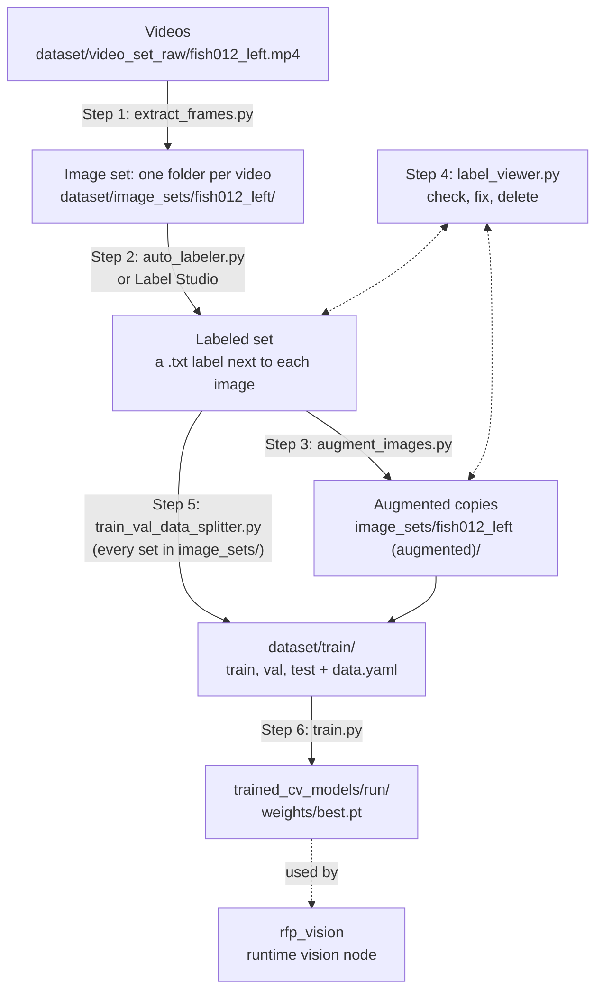

# Vision

Turns camera frames into a list of fish, each with its mask, keypoints, position and heading in the arm base frame {B}, and builds the dataset and models that do it.

Implements Requirement Spec **Section 2.2 Vision System (VS)** and **Section 2.3 Vision Data and Models (VD)**; methods are in Appendix C.1 to C.4 and C.10.

| Folder | Contents |
|---|---|
| `rfp_vision/` | Runtime vision node: detection, keypoints, pose estimation, failure checks, fish list output |
| `data/` | The dataset and training tools below ([details](data/README.md)) |
| `trained_cv_models/` | One folder per training run; `weights/best.pt` is the model (not in Git) |
| `configs/` | Camera settings, model paths and thresholds |

## Building the fish model

Six scripts in `data/`, each feeding the next (`rfp` environment). Without arguments they ask for inputs in popups; each prints the next step; `--help` lists options.

| Step | Run (from `Vision/data/`) | What you do | Result |
|---|---|---|---|
| 1. Frames | `python preprocessing/extract_frames.py` | Pick videos (`.mp4`, `.bag`, `.db3`) and frames per second. Name videos by fish and view: `fish012_left.mp4`. | `dataset/image_sets/<video name>/`, minus blurry and near-duplicate frames |
| 2. Label | `python annotating/auto_labeler.py` | Pick a set, switch to **Auto-label** (G), click each fish, check the cyan outline, Enter, Right. No fish in the image: B. Or Label Studio, exporting YOLO labels next to the images. | A `.txt` label next to each image |
| 3. Augment | `python annotating/augment_images.py` (`--all`: every set) | Pick a labeled set and copies per image. Lighting, white balance, motion blur, noise, shadow; pixels only, so labels copy unchanged (polygons past the edge are cut at it). | `dataset/image_sets/<set> (augmented)/` |
| 4. Review | `python annotating/label_viewer.py` | Step through any set: drag corners, delete bad polygons or images (same as the auto labeler's Edit mode). | Fixed labels; deleted images in `<set>/_deleted/` |
| 5. Split | `python dataset/train/train_val_data_splitter.py` | Check the split it shows, confirm. | `dataset/train/` (80/10/10 train/val/test), `data.yaml` |
| 6. Train | `python training/train.py` | Settings: `training/fish_seg.yaml`; override on the command line (`epochs=5`). | `trained_cv_models/<name>_<model>_<date>_<time>/`, scored on train/val/test |

All labeling tools read and write the same YOLO polygon files. Fix labels in the original set, then re-run step 3 (it replaces the copies). Step 5 rebuilds `dataset/train/` from scratch: re-run it after labeling.

## Runtime (`rfp_vision`)

- **Image acquisition (VS-10):** aligned color and depth from the RealSense D405 through realsense2_camera
- **Detection and segmentation (VS-20):** YOLO26 segmentation model
- **Keypoints (VS-30):** YOLO26 pose model
- **Pose and geometry (VS-40):** position and heading in {B} from depth and the hand-eye calibration
- **Output (VS-50, IF-20):** fish list topic to ControlSys
- **Failure flagging (VS-60):** checks that mark unreliable detections
